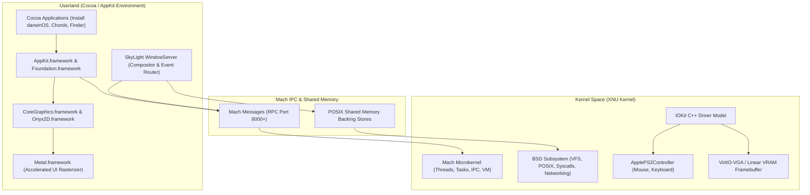

# darwinOS

<p align="center">
  
</p>

> [!IMPORTANT]
> **Правовое уведомление / Legal & Clean-Room Disclaimer:**
> Проект **darwinOS** является независимым исследовательским и образовательным проектом с открытым исходным кодом. darwinOS **не связан, не спонсируется и не поддерживается компанией Apple Inc.** Все торговые марки («Apple», «macOS», «Mac OS X», «Cocoa», «AppKit», «Metal», «Aqua») принадлежат компании Apple Inc. и упоминаются исключительно в целях описания технической совместимости в рамках доктрины добросовестного использования (Fair Use / 15 U.S.C. § 1115(b)(4)). Все пользовательские подсистемы (SkyLight WindowServer, Metal, AppKit) созданы с нуля методом «чистой комнаты» (Clean-Room Reverse Engineering) исключительно для обеспечения совместимости и интероперабельности (17 U.S.C. § 1201(f)). Ядро Darwin/XNU используется на основе официальной открытой лицензии Apple Public Source License (APSL 2.0). Подробнее см. в [LEGAL.md](LEGAL.md).


**darwinOS** — открытая операционная система, основанная на гибридном ядре **XNU** (Mach + BSD), графическом сервере **SkyLight WindowServer** и нативной среде исполнения **Cocoa / AppKit**. Проект нацелен на полную бинарную и исходную совместимость с macOS, современный визуальный дизайн macOS 26 Tahoe и работу как в гипервизорах (QEMU/KVM/WHPX), так и на реальном x86_64 оборудовании.

---

## 📑 Разделы документации (API & Guides)

- 📘 [**Базовая информация и запуск (README)**](README.md) — обзор системы, архитектура и запуск
- ⚙️ [**API разработки драйверов (IOKit & Kexts)**](docs/API_DRIVERS.md) — создание драйверов, IOKit, ApplePS2, графика и ввод
- 🎨 [**API разработки приложений (AppKit & Cocoa)**](docs/API_APPKIT.md) — создание графических окон, контролов, курсоров и событий
- 🛠️ [**Руководство разработчика (System Architecture & Build)**](docs/DEVELOPMENT.md) — сборка системы, ядро XNU, компилятор и отладка
- ⚖️ [**Правовая информация и лицензии (LEGAL & Compliance)**](LEGAL.md) — APSL 2.0, торговые марки и отказ от ответственности

---

## 🏛️ Архитектура системы



---

## 🚀 Основные особенности

1. **Ядро XNU x86_64:**
   - Полноценная поддержка многозадачности, вытесняющей многопоточности, Mach IPC и POSIX-вызовов.
   - Механизм единого prelinked `kernelcache` с встроенными kexts и init-payload.
2. **SkyLight WindowServer:**
   - Аппаратно-ускоренный Metal-композитор оконных слоёв в реальном времени.
   - macOS 26 Tahoe styling: скругление окон $R=16$, панель заголовка 32px, traffic lights (кнопки закрытия, сворачивания, масштабирования) и непрерывные мягкие тени (continuous SDF drop shadows).
   - Поддержка перекрывающихся окон (painter's order) с сохранением теней и субпиксельным сглаживанием углов.
3. **Системные курсоры macOS 26 Tahoe:**
   - 19 системных типов курсоров (`arrow`, `ibeam`, `pointinghand`, `openhand`, `closedhand`, `busy` / `beachball`, `crosshair`, `resize*`, `move`, `menu`, `zoomin`, `zoomout`).
   - Настоящая анимация радужного пляжного мяча (12 фаз вращения с частотой 80 мс).
   - Полная интеграция с `NSCursor` и `[NSCursor set]` через IPC.
4. **AppKit & CoreGraphics:**
   - Нативная поддержка `NSApplication`, `NSWindow`, `NSView`, `NSTextField`, `NSButton`, обработка событий `NSEvent`.

---

## ⚡ Быстрый старт (Запуск в QEMU)

Для запуска подготовленного образа в QEMU:

```bat
"C:\Program Files\qemu\qemu-system-x86_64.exe" ^
  -name "darwinOS" ^
  -m 8G -machine q35 -cpu Penryn -smp 4,cores=4,sockets=1 ^
  -accel tcg,thread=single,tb-size=1024 ^
  -drive if=pflash,format=raw,file=OVMF_CODE_4M.fd,read-only=on ^
  -drive if=pflash,format=raw,file=OVMF_VARS.fd ^
  -drive if=ide,id=disk0,file=disk.img,format=raw ^
  -device virtio-rng-pci,rng=rng0 ^
  -device virtio-vga,xres=1280,yres=800 ^
  -serial file:serial.log ^
  -display sdl
```

---

## 🔬 Чистая комната и совместимость (Clean-Room Reverse Engineering)

Все проприетарные пользовательские подсистемы и графические компоненты darwinOS — включая оконный сервер **SkyLight WindowServer**, модуль 2D-растеризации **Metal** и среду исполнения **Cocoa / AppKit** — спроектированы и разработаны независимо с нуля методом **чистой комнаты (Clean-Room Reverse Engineering)**.

Реализация опирается исключительно на общедоступную спецификацию открытых протоколов, документированное поведение и динамическое зондирование API строго в целях обеспечения **межсистемной совместимости (interoperability)** и **научно-образовательных исследований операционных систем**, в полном соответствии с:
- **17 U.S.C. § 1201(f)** (Исключение DMCA для обратной разработки в целях совместимости программ)
- Прецедентом Верховного суда США по делу **Oracle America, Inc. v. Google LLC**, 141 S. Ct. 1183 (2021) (правомерное использование функциональных объявлений интерфейсов API)
- Прецедентами **Sony Computer Entertainment, Inc. v. Connectix Corp.**, 203 F.3d 596 (9th Cir. 2000) и **Sega Enterprises Ltd. v. Accolade, Inc.**, 977 F.2d 1510 (9th Cir. 1992)
- Директивой Европейского Союза **Directive 2009/24/EC**, ст. 5(3) и 6 (декомпиляция и наблюдение функционирования ПО для достижения интероперабельности).

Данные подсистемы не содержат дизассемблированного, декомпилированного или скопированного проприетарного исходного кода или бинарных файлов Apple Inc.

---

## 📜 Лицензия

Проект распространяется под лицензиями Apple Public Source License (APSL 2.0) и MIT License.
