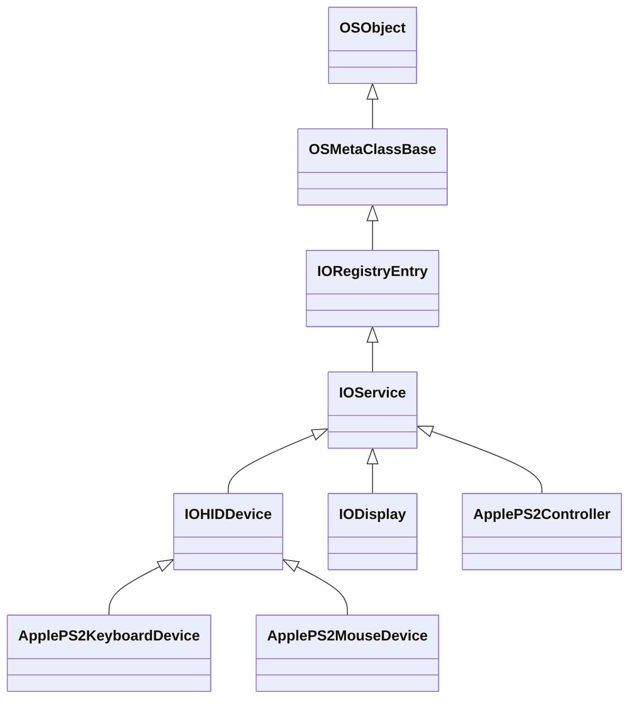

# Руководство по разработке драйверов для darwinOS (IOKit API)

В darwinOS драйверы устройств работают в рамках объектно-ориентированной модели **IOKit** ядра XNU. Драйверы пишутся на подмножестве C++ (без исключений и RTTI) и компилируются в расширения ядра (**Kext** — Kernel Extension) либо в пространства пользователя (DriverKit).

---

## 1. Базовые классы IOKit

Иерархия основных классов подсистемы ввода и управления оборудованием:



- **`OSObject`** — базовый класс с подсчётом ссылок (`retain()`, `release()`).
- **`IOService`** — фундаментальный класс жизненного цикла любого драйвера в IOKit.
- **`IOHIDDevice` / `IOHIDPointing`** — специализированные сервисы для устройств ввода (мышь, клавиатура, сенсорный экран).

---

## 2. Жизненный цикл драйвера (IOService Lifecycle)

Каждый драйвер реализует четыре ключевых метода:

```cpp
#include <IOKit/IOService.h>

class MyCustomDriver : public IOService {
    OSDeclareDefaultStructors(MyCustomDriver);

public:
    virtual bool init(OSDictionary *properties = 0) override;
    virtual IOService *probe(IOService *provider, SInt32 *score) override;
    virtual bool start(IOService *provider) override;
    virtual void stop(IOService *provider) override;
    virtual void free() override;
};
```

### Этапы работы:
1. **`init()`**: Первичная аллокация структур данных, сброс переменных.
2. **`probe()`**: Опрос аппаратных ID (PCI Vendor/Device, ACPI, USB, PS/2). Драйвер возвращает ненулевой указатель и оценку `*score`, если устройство поддерживается.
3. **`start()`**: Инициализация аппаратного интерфейса, регистрация прерываний (`IOInterruptEventSource`), запуск очередей обработки (`IOWorkLoop`).
4. **`stop()`**: Отключение прерываний, завершение очередей и отключение от провайдера.
5. **`free()`**: Освобождение памяти и отложенных ссылок.

---

## 3. Пример: Обработка событий мыши (PS/2 Mouse)

В `Kernel/Extensions/ApplePS2Controller/ApplePS2MouseDevice.cpp` реализован драйвер мыши PS/2:

```cpp
void ApplePS2MouseDevice::packetReady(const uint8_t packet[3])
{
    int buttons = (packet[0] & 0x01) | ((packet[0] & 0x02) << 1);
    int dx = packet[1] - ((packet[0] & 0x10) ? 256 : 0);
    int dy = packet[2] - ((packet[0] & 0x20) ? 256 : 0);

    /* Отправка событий в общую подсистему IOHID */
    dispatchRelativePointerEvent(dx, -dy, buttons);
}
```

---

## 4. Конфигурация Info.plist для Kext

Каждый драйвер описывается манифестом `Info.plist`:

```xml
<?xml version="1.0" encoding="UTF-8"?>
<!DOCTYPE plist PUBLIC "-//Apple//DTD PLIST 1.0//EN" "http://www.apple.com/DTDs/PropertyList-1.0.dtd">
<plist version="1.0">
<dict>
    <key>CFBundleIdentifier</key>
    <string>org.darwinos.driver.MyCustomDriver</string>
    <key>IOKitPersonalities</key>
    <dict>
        <key>MyCustomDriver</key>
        <dict>
            <key>CFBundleIdentifier</key>
            <string>org.darwinos.driver.MyCustomDriver</string>
            <key>IOClass</key>
            <string>MyCustomDriver</string>
            <key>IOProviderClass</key>
            <string>IOPCIDevice</string>
            <key>IOPCIMatch</key>
            <string>0x12348086</string>
        </dict>
    </dict>
    <key>OSBundleLibraries</key>
    <dict>
        <key>com.apple.kpi.iokit</key>
        <string>19.0.0</string>
        <key>com.apple.kpi.libkern</key>
        <string>19.0.0</string>
    </dict>
</dict>
</plist>
```

---

## 5. Сборка драйверов

Компиляция драйвера осуществляется кросс-компилятором Clang с целевой платформой `x86_64-apple-darwin19`:

```bash
clang++ -target x86_64-apple-darwin19 \
  -nostdinc++ -fno-rtti -fno-exceptions -fno-builtin \
  -mkernel -DAPPLE -DKERNEL -I${XNU_HEADERS} \
  -c MyDriver.cpp -o MyDriver.o
```
